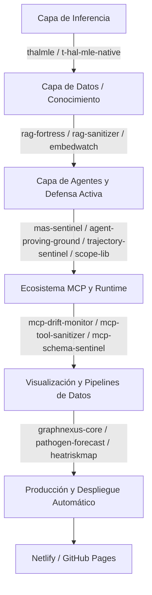

<!--
  Copyright (C) 2026 Pedro Sordo Martínez <amurlaniakea@gmail.com>
  SPDX-License-Identifier: AGPL-3.0-or-later
  Hub técnico del portafolio MagoPredator — compatible con sitio estático (HTML+CSS, sin build).
-->

# ⚡ MagoPredator — Tecnósfera Al Servicio De La Biósfera

> **Portafolio técnico de Ingeniería de Investigación, Seguridad Semántica e Inferencia de Élite.**
> Autor: Pedro Sordo Martínez (Sil) — `amurlaniakea@gmail.com`

---

## Identidad y Lema Principal

- **Lema operativo:** `⚡ Tecnósfera Al Servicio De La Biósfera`
- **Enfoque:** AI Safety, Inferencia Estadística Avanzada, Ciberseguridad Defensiva en LLMs y Sistemas Multi-Agente (`MAS`), DevSecOps.
- **Gobernanza:** Todo el ecosistema opera bajo `AGPL-3.0-or-later` (`LICENSE` verbatim, cabeceras `SPDX` en cada archivo fuente). `CI` obligatorio (`.github/workflows/ci.yml`) desde el primer commit (`git init`). Anti-leak con `gitleaks`.
- **Sitio estático:** El repositorio mantiene la estructura original (`index.html`, `styles.css`) — sin frameworks, sin backend, sin build. Este `README.md` funciona como mapa técnico del hub, no reemplaza el render estático del sitio.

---

## 🏛️ Arquitectura del Ecosistema



---

## 🔬 A. Inferencia Estadística & Aprendizaje No Paramétrico

| Proyecto / Repo | Descripción Técnica / Paper Ancla | Capa / Estado | Acceso / Producción |
|---|---|---|---|
| **thalmle** | Implementación nativa de T-HAL-MLE para curvas dosis-respuesta continuas (arXiv:2607.03824). Estimación determinista sin supuestos paramétricos. | Inferencia / Estable | GitHub |
| **t-hal-mle-native** | Versión nativa y optimizada del estimador T-HAL-MLE, con validación matemática estricta de la convergencia en datos continuos. | Inferencia / Estable | GitHub |

---

## 🏰 B. Seguridad en RAG & Sanitización de Datos

| Proyecto / Repo | Descripción Técnica / Paper Ancla | Capa / Estado | Acceso / Producción |
|---|---|---|---|
| **rag-fortress** | Framework unificado de defensa RAG contra `InceptionRAG` (arXiv:2609.16818) y `MIA` (arXiv:2509.20324) con `IsolationForest` + heurística coseno. Score determinista `[0,100]`. CI verificado (`.github/workflows/ci.yml`). | Defensa Semántica / Professional Grade | [Repo](https://github.com/amurlaniakea/rag-fortress) |
| **rag-sanitizer** | Escáner pre-ingesta (`semantic mimicry`, `entity-swap`). Intercepta vectores anómalos antes de la indexación. | Sanitización / Estable | GitHub |
| **embedwatch** | Auditoría defensiva de riesgo de traducibilidad para dumps de embeddings. Detección de fuga de información latente en representaciones vectoriales. | Auditoría / Estable | GitHub |

---

## 🛡️ C. Defensa Activa Multi-Agente & Capas de Aislamiento

### Sistemas Multi-Agente (MAS) y Defensa Perimetral

| Proyecto / Repo | Descripción Técnica / Paper Ancla | Capa / Estado | Acceso / Producción |
|---|---|---|---|
| **mas-sentinel** | Interceptor en tiempo real y motor de políticas `OWASP MAS`. Bloquea propagación de inyección de prompts entre agentes (`arXiv:2610.12524`). Estado verificado en `main`. | Defensa Activa / Estable | [Repo](https://github.com/amurlaniakea/mas-sentinel) |
| **agent-proving-ground** | Evaluación adversaria determinista (`jailbreak`, `bypass`, `system override`). Escenarios reproducibles con `pytest`. | Evaluación / Estable | GitHub |
| **trajectory-sentinel** | Seguimiento y trazabilidad de trayectorias de razonamiento (`CoT`). Detección de desviaciones semánticas. | Monitoreo / Estable | GitHub |

### Módulos de Control en Runtime

| Proyecto / Repo | Descripción Técnica / Estado | Capa / Estado | Acceso / Producción |
|---|---|---|---|
| **scope-lib** | Biblioteca de delimitación de alcance (`scope`) para ejecución controlada. | Runtime / Estable | GitHub |
| **adi-shield** | Capa de aislamiento defensivo para procesos de inferencia. | Runtime / Estable | GitHub |
| **wallet-guard** | Protección determinista de credenciales y claves. | Seguridad de Credenciales / Estable | GitHub |
| **goal-anchor** | Anclaje y verificación de objetivos operativos. | Gobernanza / Estable | GitHub |

### Ecosistema MCP

| Proyecto / Repo | Descripción Técnica / Estado | Capa / Estado | Acceso / Producción |
|---|---|---|---|
| **mcp-drift-monitor** | Monitoreo de deriva (`drift`) en servidores MCP. | Monitoreo / Estable | GitHub |
| **mcp-tool-sanitizer** | Sanitizador de herramientas (`>=0.1.0`). Validación de firmas. | Sanitización / Estable | [Repo](https://github.com/amurlaniakea/mcp-tool-sanitizer) |
| **mcp-schema-sentinel** | Auditoría de esquemas expuestos. Prevención de inyección indirecta. | Auditoría / Estable | GitHub |

---

## 📊 D. Visualización Avanzada, Pipelines de Datos & Biosfera

| Proyecto / Repo | Descripción Técnica / Estado | Capa / Estado | Acceso / Producción |
|---|---|---|---|
| **graphnexus-core** | Gráficos de fuerza 3D con `WebGL`. Visualización interactiva de redes. | Visualización / Estable | [Netlify / GitHub Pages](https://graphnexus.netlify.app) |
| **pathogen-forecast** | Visor epidemiológico global `SIR/SEIR`. Datos calibrados con trazabilidad. | Salud Pública / Estable | [GitHub Pages](https://amurlaniakea.github.io/pathogen-forecast) |
| **heatriskmap** | Análisis `UHI` con `Landsat` + `OSM`. Mapeo térmico sostenible. | Clima / Estable | [Netlify](https://heatriskmap.netlify.app) |

> **Nota de Despliegue Automático:** Todos los visores interactivos (`graphnexus-core`, `pathogen-forecast`, `heatriskmap`) se renderizan y publican automáticamente mediante `CI/CD` (`Netlify` / `GitHub Pages`). Cada `push` a `main` dispara reconstrucción inmediata.

---

## Estructura del Sitio Estático (Este Repositorio)

- `index.html` — 5 secciones: hero, proyectos, artículos, HN, contacto.
- `styles.css` — estilos puros, sin `JavaScript`, sin frameworks, sin backend.
- Vista previa local: `python3 -m http.server 8000` → `http://localhost:8000`.

---

## Contacto y Firma Técnica

```
Pedro Sordo Martínez — amurlaniakea@gmail.com
⚡ Tecnósfera Al Servicio De La Biósfera
AGPL-3.0-or-later — 2026
Profesional. Preciso. Verificado.
```
